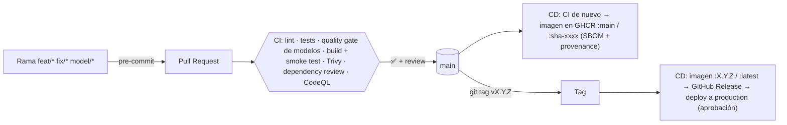

# 📊 Credit Risk Classification – Cooperativa Financiera

[](https://github.com/JuanCamiloMB/credit-risk-classification/actions/workflows/cd.yml)
[](https://github.com/JuanCamiloMB/credit-risk-classification/actions/workflows/codeql.yml)

[](https://docs.astral.sh/uv/)
[](https://docs.astral.sh/ruff/)

## 📌 Descripción del proyecto

Este proyecto tiene como objetivo el desarrollo de un modelo de **clasificación de riesgo crediticio** basado en datos históricos de una cooperativa financiera.

El dataset contiene información consolidada de créditos otorgados a los asociados, incluyendo variables financieras, socioeconómicas, geográficas y de comportamiento con la cooperativa.

La variable objetivo es:

- **`default`**
  - `1`: El cliente incurrió en impago (default)
  - `0`: El cliente se encuentra al día con sus obligaciones

El propósito principal del análisis es **identificar patrones asociados al incumplimiento de pago**, para posteriormente construir un modelo predictivo que apoye la toma de decisiones en la aprobación y seguimiento de créditos.

---

## 📁 Estructura del proyecto

```
credit-risk-classification/
│
├── app.py                  # Entrada principal (Streamlit)
├── config.py               # Constantes globales (paths, nombres bonitos, colores)
├── styles.py               # CSS inyectado en la app
├── tabs/                   # Una pestaña por archivo (overview, eda, models, predictor)
├── utils/                  # Loaders + helpers de métricas
├── data/                   # Dataset original y procesado (.parquet)
├── models/                 # Modelos entrenados (.joblib)
├── notebooks/              # Análisis y entrenamiento (Jupyter)
├── tests/                  # Pruebas unitarias, contrato/quality gate de modelos y smoke tests de la app
│
├── .github/                # CI/CD, CodeQL, Dependabot, plantillas de PR/issues, CODEOWNERS
├── .streamlit/config.toml  # Configuración compartida de Streamlit
├── Dockerfile              # Imagen de producción (multi-stage, no-root, healthcheck)
├── compose.yaml            # Ejecución local de la imagen endurecida
├── Makefile                # Atajos: make setup / lint / test / run / docker-run
├── .pre-commit-config.yaml # Hooks de calidad (los mismos que corre CI)
├── pyproject.toml          # Dependencias (runtime / dev / notebooks) y config de herramientas
├── uv.lock                 # Lockfile: única fuente de verdad de versiones
├── CONTRIBUTING.md         # Flujo de trabajo, releases, despliegue y reentrenamiento
└── README.md
```

---

## ⚙️ Requisitos

- Python **3.11**
- [uv](https://docs.astral.sh/uv/) (gestor de entornos y dependencias)
- Docker (opcional, para ejecutar la imagen de producción)
- **macOS:** LightGBM necesita OpenMP → `brew install libomp`

---

## 🚀 Inicio rápido

```bash
git clone https://github.com/JuanCamiloMB/credit-risk-classification.git
cd credit-risk-classification
```

Instalar dependencias y hooks de git (una sola vez):

```bash
make setup
```

Lanzar la app en http://localhost:8501:

```bash
make run
```

O con Docker, exactamente como corre en producción:

```bash
docker compose up --build
```

<details>
<summary>Sin <code>make</code> (p. ej. Windows)</summary>

```bash
uv sync --locked
uv run pre-commit install
uv run streamlit run app.py
```

</details>

La app expone cuatro pestañas:

1. **Resumen del Dataset** — KPIs, distribución del target y estadísticas descriptivas.
2. **Análisis Exploratorio** — histogramas, boxplots, correlaciones y heatmap.
3. **Resultados de los Modelos** — métricas, ROC / PR, matrices de confusión, importancia de variables.
4. **Predictor en Vivo** — formulario para predecir la probabilidad de default de un nuevo cliente.

---

## 🛠️ Comandos de desarrollo

| Comando             | Qué hace                                                          |
|---------------------|-------------------------------------------------------------------|
| `make lint`         | Todos los chequeos de pre-commit (los mismos que CI)              |
| `make format`       | Formatea y corrige el código con ruff                             |
| `make test`         | Suite completa de pruebas con cobertura (mínimo 80 %)             |
| `make test-fast`    | Pruebas sin las lentas (omite la app completa)                    |
| `make docker-test`  | Pruebas dentro de Linux (útil en macOS sin `libomp`)              |
| `make docker-run`   | Construye y ejecuta la imagen de producción                       |
| `make requirements` | Exporta `requirements.txt` desde `uv.lock` si una plataforma lo pide |

---

## 🔄 Flujo DevOps



- **Integración continua:** cada PR ejecuta lint, pruebas (unitarias, contrato de modelos, quality gate de Recall/ROC-AUC y smoke test de la app completa), build de la imagen con smoke test del contenedor, escaneo de vulnerabilidades con Trivy, revisión de dependencias y análisis CodeQL.
- **Entrega continua:** cada merge a `main` publica una imagen inmutable en `ghcr.io`; cada tag `vX.Y.Z` crea un GitHub Release y despliega al environment `production`.
- **Seguridad de la cadena de suministro:** actions fijadas por SHA, imágenes base fijadas por digest, lockfile, SBOM y provenance en cada imagen, permisos mínimos del `GITHUB_TOKEN`, contenedor no-root y de solo lectura.
- **Mantenimiento:** Dependabot actualiza semanalmente dependencias de Python, actions e imágenes base.

El detalle (ramas, commits, releases, despliegue, rollback y cómo reentrenar) está en [CONTRIBUTING.md](CONTRIBUTING.md).

---

## 🧠 Reentrenamiento

Los notebooks se ejecutan en orden:

```bash
uv run jupyter lab notebooks/
# 01_descarga_datos.ipynb
# 02_ajuste_tratamiento_datos.ipynb
# 03_EDA.ipynb
# 04.AutoML.ipynb
# 05_entrenamiento_modelo.ipynb
# 06_interpretación_modelos.ipynb
```

Los modelos se guardan en `models/` como `.joblib` y la app los carga automáticamente. Antes de desplegar un modelo nuevo, `tests/test_models.py` verifica que cargue con las mismas versiones de librerías con que se entrenó y que supere el quality gate en el holdout. Ver [CONTRIBUTING.md](CONTRIBUTING.md#-reentrenar-o-cambiar-modelos).

---

## 🧠 Metodología

1. Limpieza y preparación de datos
2. Análisis exploratorio (EDA)
3. Realización de AutoML usando herramientas como PyCaret
4. Entrenamiento de modelos de clasificación
5. Evaluación del desempeño
6. Guardado del modelo final
7. Desarrollo del modelo y visualización usando Streamlit
